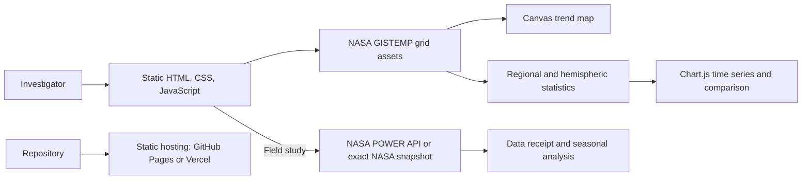

Live demo URL: **[URL PLACEHOLDER — add the GitHub Pages address after deployment]**

# Earth System Trend Detective

## 1) Project Title & Problem Statement

Earth System Trend Detective is a browser-based tool for investigating historical temperature trends from NASA GISTEMP v4. It lets students and the public inspect global, hemispheric, and selected regional anomaly records, estimate a rate per decade, and compare the Northern and Southern Hemisphere signals.

The primary GISTEMP map uses precomputed NASA temperature grid assets and a global mean series. The separate [NASA POWER field investigation](investigate.html) requests live monthly point data and labels its satellite and model reanalysis provenance. Neither source represents a local ground-station measurement at every point.

## 2) Team Details

| Role | Name | Institution | GitHub username |
|---|---|---|---|
| Team lead | **[Name to be added]** | **[Institution to be added]** | **[@username to be added]** |
| Data and science | **[Name to be added]** | **[Institution to be added]** | **[@username to be added]** |
| Design and frontend | **[Name to be added]** | **[Institution to be added]** | **[@username to be added]** |
| Outreach and presentation | **[Name to be added]** | **[Institution to be added]** | **[@username to be added]** |

## 3) Solution Overview & Architecture

The main static GISTEMP app loads a compact 2° × 2° anomaly grid, draws a spatial trend map and regional time series, and includes a side-by-side hemisphere comparison. The separate NASA POWER field investigation supports coordinates, place search, guided variable suggestions, seasonal aggregation, exact-request receipts, and matching NASA snapshots for demonstration locations.

GISTEMP trend statistics and time-series charts run in the browser. The comparison reports each hemisphere's Sen rate and Mann–Kendall p-value, plus the difference between their rates. Separate p-values do not constitute a statistical test of the difference. The POWER field study deseasonalizes monthly values and groups them by selected season before calculating trends.



**Technology stack:** HTML5, CSS3, vanilla JavaScript, NASA GISTEMP static grid assets, NASA POWER monthly API, Chart.js 4.4.7, vendored Leaflet 1.9.4 for the GISTEMP map, Open-Meteo geocoding for the POWER field study, and static hosting. There is no application server or build step. GISTEMP is the root page; NASA POWER is at [`investigate.html`](investigate.html).

NASA POWER parameter IDs were checked against the monthly endpoint: `T2M`, `T2M_MAX`, `T2M_MIN`, `PRECTOTCORR`, `RH2M`, `WS10M`, `ALLSKY_SFC_SW_DWN`, `PS`, `QV2M`, `EVLAND`, `GWETROOT`, and `GWETTOP`. Units and source metadata from each response appear in the receipt. [NASA POWER Monthly API documentation](https://power.larc.nasa.gov/docs/services/api/temporal/monthly/) · [NASA POWER Parameter Dictionary](https://power.larc.nasa.gov/parameters/).

Place-name lookup follows the [Open-Meteo geocoding API](https://open-meteo.com/en/docs/geocoding-api); returned coordinates are sent to NASA POWER only after the user selects a result.

## 4) Live Demo & Screenshots

Live URL: **[URL PLACEHOLDER — add the GitHub Pages address after deployment]**

Demo video: **[VIDEO URL PLACEHOLDER — add after recording]**

- GISTEMP hemisphere comparison: [`audit/shots/after/prd-hemisphere-comparison.png`](audit/shots/after/prd-hemisphere-comparison.png)
- NASA POWER field investigation: [`audit/shots/after/power-investigation.png`](audit/shots/after/power-investigation.png)
- Desktop chart: [`audit/shots/after/power-investigation-receipt.png`](audit/shots/after/power-investigation-receipt.png)
- Full mobile investigation and receipt: [`audit/shots/after/power-investigation-mobile.png`](audit/shots/after/power-investigation-mobile.png)
- Offline saved-case capture: [`audit/shots/after/power-investigation-snapshot.png`](audit/shots/after/power-investigation-snapshot.png)

## 5) Installation & Setup Guide

The app runs from a static file server. No package installation or API key is needed.

```powershell
python -m http.server 8000
```

Open `http://localhost:8000` using the server URL, not a `file://` path. GISTEMP fetches `data/grid-metadata.json`, `data/annual-grid.bin`, and `data/global-mean.csv` relative to the site root. The NASA POWER field study needs internet for live requests; matching NASA snapshots support its demo cases.

Run the dependency-free JavaScript tests with Node.js 22:

```powershell
node --test src/stats/index.test.js src/data/power.test.js
```

Regenerate the eight raw NASA POWER snapshots with Node.js 22 and an internet connection:

```powershell
node scripts/fetch-snapshots.mjs
```

Run the randomized three-case receipt check before each milestone:

```powershell
node scripts/check-power-receipts.mjs
```

Recompute the independent Python report (SciPy and NumPy are already listed in `requirements.txt`):

```powershell
python scripts/verify.py
```

The app deploys as static files through the existing GitHub Pages workflow. Do not commit API credentials; NASA POWER does not require an API key for these requests.

For CARTO Voyager tiles on Vercel, set `CARTO_API_KEY` in the project's Environment Variables and redeploy. The build writes the key into the generated browser config; restrict that key by allowed domains in CARTO. Without the variable, the map uses CARTO's dark raster tiles, which may display the provider's key notice.

## 6) AI Usage Disclosure

Codex generated the P0 investigation interface, data parser, statistical module, tests, snapshot and verification scripts, and documentation in this repository. The eight response snapshots were fetched directly from NASA POWER by the documented script and were not edited by hand. Test fixtures are confined to tests and are never shown in the app. The full file-by-file disclosure, including remaining human review, is in [`AI_USAGE.md`](AI_USAGE.md).

`pymannkendall` was not installed because this project was kept dependency-free at the user's direction. `scripts/verify.py` compares the JavaScript results against independent SciPy and Python calculations and records the limitation in [`docs/verification.md`](docs/verification.md).
