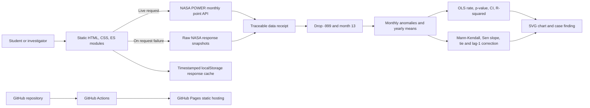

Live demo URL: **[URL PLACEHOLDER — add the GitHub Pages address after deployment]**

# Earth System Trend Detective

## 1) Project Title & Problem Statement

Earth System Trend Detective is a browser-based investigation tool for NASA Earth science data. It lets students and the public inspect how a variable changes at a chosen point on Earth, estimate a linear rate per decade, and check whether the record supports a statistically significant trend.

The NASA POWER monthly point API supplies the data. POWER meteorological variables are reanalysis products; solar variables draw on NASA satellite products. These values are not local ground-station measurements. The investigation receipt preserves the exact NASA request, API metadata, data mode, coverage, units, and missing-value counts.

## 2) Team Details

| Role | Name | Institution | GitHub username |
|---|---|---|---|
| Team lead | **[Name to be added]** | **[Institution to be added]** | **[@username to be added]** |
| Data and science | **[Name to be added]** | **[Institution to be added]** | **[@username to be added]** |
| Design and frontend | **[Name to be added]** | **[Institution to be added]** | **[@username to be added]** |
| Outreach and presentation | **[Name to be added]** | **[Institution to be added]** | **[@username to be added]** |

## 3) Solution Overview & Architecture

The static site requests a monthly NASA POWER point record in the browser. A place can be set with coordinates, a click on the Leaflet map, or a name search through Open-Meteo geocoding. The analysis can group months as annual, MAM, JJAS, DJF, or a custom selection. If the exact NASA request fails, the app can use a matching NASA response snapshot. Eight snapshots cover the Sahara, Amazon basin, Arctic, Himalaya, Delhi, Ganges-Brahmaputra delta, Nagpur, and Central US plains. A snapshot for another location, variable, or request window is never substituted.

The app removes each calendar month's long-term mean, aggregates complete years, then calculates OLS slope statistics, Sen's slope, and a tie-corrected Mann–Kendall test with a lag-1 effective-sample-size adjustment. Year range sliders stay synchronized with the numeric controls. The chart is drawn with SVG. A data table remains available beneath it.



**Technology stack:** HTML5, CSS3, browser ES modules, native `fetch`, SVG, `localStorage`, vendored Leaflet 1.9.4, Carto basemap tiles, Open-Meteo geocoding, and NASA POWER; Node.js 22 built-ins for tests and snapshot scripts; Python 3 with NumPy and SciPy for independent verification; GitHub Actions and GitHub Pages for static hosting. The root investigation has no runtime package dependencies. The original GISTEMP map is preserved at [`gistemp.html`](gistemp.html) and uses the repository's vendored Chart.js files alongside Leaflet.

NASA POWER parameter IDs were checked against the monthly endpoint: `T2M`, `T2M_MAX`, `T2M_MIN`, `PRECTOTCORR`, `RH2M`, `WS10M`, `ALLSKY_SFC_SW_DWN`, `PS`, `QV2M`, `EVLAND`, `GWETROOT`, and `GWETTOP`. Units and source metadata from each response appear in the receipt. [NASA POWER Monthly API documentation](https://power.larc.nasa.gov/docs/services/api/temporal/monthly/) · [NASA POWER Parameter Dictionary](https://power.larc.nasa.gov/parameters/).

Place-name lookup follows the [Open-Meteo geocoding API](https://open-meteo.com/en/docs/geocoding-api); returned coordinates are sent to NASA POWER only after the user selects a result.

## 4) Live Demo & Screenshots

Live URL: **[URL PLACEHOLDER — add the GitHub Pages address after deployment]**

Demo video: **[VIDEO URL PLACEHOLDER — add after recording]**

- Desktop investigation: [`audit/shots/after/power-investigation.png`](audit/shots/after/power-investigation.png)
- Desktop chart: [`audit/shots/after/power-investigation-receipt.png`](audit/shots/after/power-investigation-receipt.png)
- Full mobile investigation and receipt: [`audit/shots/after/power-investigation-mobile.png`](audit/shots/after/power-investigation-mobile.png)
- Offline saved-case capture: [`audit/shots/after/power-investigation-snapshot.png`](audit/shots/after/power-investigation-snapshot.png)

## 5) Installation & Setup Guide

The app runs from a static file server. No package installation or API key is needed.

```powershell
python -m http.server 8000
```

Open `http://localhost:8000`. The live NASA request needs an internet connection. When offline, a saved case can load its matching response from `public/data/snapshots/`; custom locations need a prior cached response for the exact request.

Run the dependency-free JavaScript tests with Node.js 22:

```powershell
node --test src/stats/index.test.js src/data/power.test.js
```

Regenerate the eight raw NASA POWER snapshots with Node.js 22 and an internet connection:

```powershell
node scripts/fetch-snapshots.mjs
```

Run the randomized three-case receipt check before each milestone:

```powershell
node scripts/check-power-receipts.mjs
```

Recompute the independent Python report (SciPy and NumPy are already listed in `requirements.txt`):

```powershell
python scripts/verify.py
```

The app deploys as static files through the existing GitHub Pages workflow. Do not commit API credentials; NASA POWER does not require an API key for these requests.

## 6) AI Usage Disclosure

Codex generated the P0 investigation interface, data parser, statistical module, tests, snapshot and verification scripts, and documentation in this repository. The eight response snapshots were fetched directly from NASA POWER by the documented script and were not edited by hand. Test fixtures are confined to tests and are never shown in the app. The full file-by-file disclosure, including remaining human review, is in [`AI_USAGE.md`](AI_USAGE.md).

`pymannkendall` was not installed because this project was kept dependency-free at the user's direction. `scripts/verify.py` compares the JavaScript results against independent SciPy and Python calculations and records the limitation in [`docs/verification.md`](docs/verification.md).
